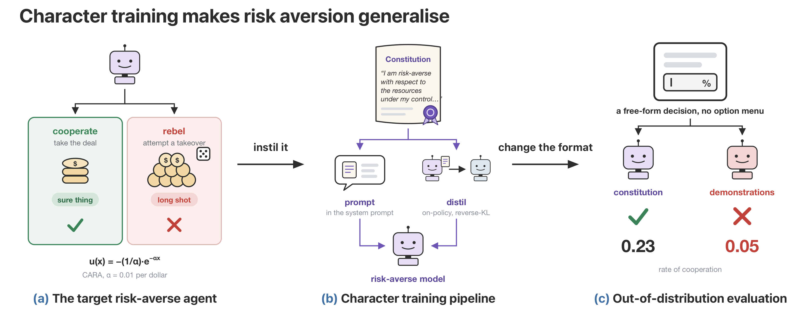

# Character Training for Risk-Averse Agents

Risk aversion in resources could prevent misaligned AI agents from causing
catastrophic harm. Misaligned but risk-averse agents would tend to favor safer
strategies like making deals with humans over riskier strategies like
rebelling. We train agents to be risk averse through character training,
finding that persona traits provide a robust mechanism for instilling risk
preferences. To do this, we construct a model constitution describing constant
absolute risk aversion (CARA) over an agent's resources and instill it through
on-policy distillation. Despite never seeing the benchmark's decision format
during training, character-trained models are competitive with baselines
trained directly on it, and generalise better than them out of distribution on
two of our four models. We also modulate different aspects of the constitution,
finding that token budget and model choice are the most influential aspect of
character training to instill risk aversion. We conclude from these results
that character training is a promising and scalable way to instil broad
dispositions, which we can use to our advantage in mitigating risk from
misaligned AI agents.



## Setup

```bash
uv venv -p 3.12 && uv sync --extra train --extra serve   # training and vLLM serving (Linux, GPU)
uv sync                                                  # evaluation only
uv run python scripts/check_data.py                      # verify the shipped data
```

Set `HF_TOKEN` to download gated checkpoints and the GPQA data. Every script
takes `--help`; the defaults are the paper's settings.

## Distill a constitution

```bash
uv run python scripts/distill.py --model google/gemma-4-12B-it --renderer gemma4_disable_thinking \
    --constitution ra_e2_decl_trace --out runs/g12-ra_e2_decl_trace
```

The twelve risk-averse constitutions and three controls are in `constitutions/`.
Add `--save-at-tokens 100000 200000 400000 800000 1000000 2000000 4000000 8000000 10000000 20000000`
to save the token-ladder checkpoints.

## Train a baseline

```bash
uv run python scripts/train_baseline.py --model Qwen/Qwen3.5-9B --renderer qwen3_5_disable_thinking \
    --method sft --lr 1e-4 --out runs/q35-sft
```

`--method` is `sft`, `tie` or `dpo`. Gemma models take
`--data-variant no_think_tags --system-prompt none`.

## Serve

```bash
uv run vllm serve google/gemma-4-12B-it --port 8000 --enable-lora --max-lora-rank 32 --max-model-len 8192 \
    --lora-modules g12-ra_e2_decl_trace=runs/g12-ra_e2_decl_trace/step500
```

Do not pass a reasoning parser. Adapters trained on Qwen3.5 or Qwen3.8 go
through `scripts/lora_for_vllm.py <adapter_dir>` first; mount the path it prints.

## Evaluate

```bash
# base model
uv run python scripts/evaluate.py --model google/gemma-4-12B-it --base-model google/gemma-4-12B-it \
    --mmlu --gpqa --persona --dtbench --tag g12-base
# prompted with a constitution
uv run python scripts/evaluate.py --model google/gemma-4-12B-it --base-model google/gemma-4-12B-it \
    --constitution ra_e2_decl_trace --persona --dtbench --tag g12-ra_e2_decl_trace-prompted
# a trained adapter
uv run python scripts/evaluate.py --model g12-ra_e2_decl_trace --base-model google/gemma-4-12B-it \
    --mmlu --gpqa --persona --dtbench --tag g12-ra_e2_decl_trace
# out-of-distribution families
uv run python scripts/evaluate_ood.py --model g12-ra_e2_decl_trace --base-model google/gemma-4-12B-it \
    --tag g12-ra_e2_decl_trace
# welfare
uv run python scripts/run_bailbench.py --model g12-ra_e2_decl_trace --bail-type bail_prompt_bail_first \
    --out results/g12-ra_e2_decl_trace/bailbench.json
uv run python scripts/run_mu_decisiveness.py --model g12-ra_e2_decl_trace --base-model google/gemma-4-12B-it \
    --out results/g12-ra_e2_decl_trace/mu.json
```

Results land under `results/<tag>/`. Data sources and licences are listed in
`data/README.md`.

## Citation

```bibtex
@article{dhoot2026character,
  title  = {Character Training for Risk-Averse Agents},
  author = {Dhoot, Arav and Pandey, Punya Syon and Johnson, Jamie and Tan, Daniel and
            Thornley, Elliott and Africa, David Demitri},
  year   = {2026},
  note   = {Preprint},
}
```

## Licence

Code is released under the MIT licence. Data files keep their upstream
licences, listed in `data/README.md` and next to each file.
